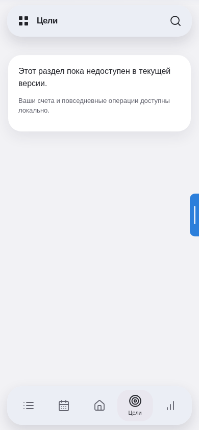
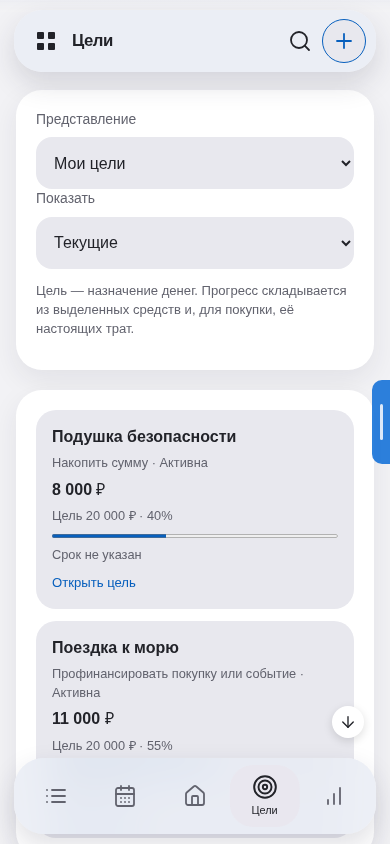
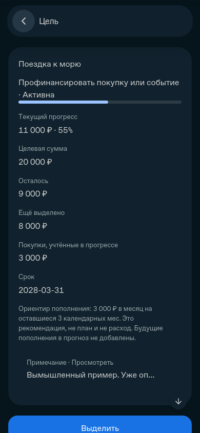
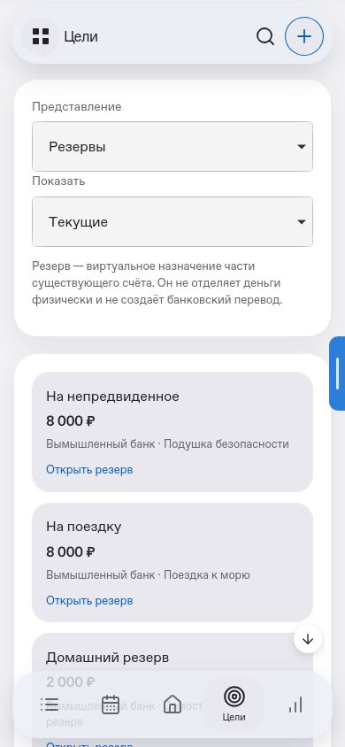

# P3 — реальные скриншоты

Все снимки сделаны Playwright из настоящих семи public-файлов на localhost. Только вымышленные финансовые данные. Движки — Chromium и WebKit, deviceScaleFactor1; размер PNG равен CSS viewport. Это не физический iPhone и не доказательство аппаратной клавиатуры/PWA.

**До:** оригинальные public-файлы main3add5d9 (P2), неизменённые; «Цели» — заглушка. **После:** p3-goals01, действующие компоненты и палитры FinRate. Основной browser-driver проверяет7 размеров×4 сочетания, отдельный tools/p3-screenshots.mjs снимает понятный пример: накопление8 000/20 000 (40%); поездка — резерв8 000 +покупка3 000 =11 000/20 000 (55%); самостоятельный резерв2 000. В приложении нет предустановленных демонстрационных сумм.

| Сценарий | Chromium | WebKit |
|---|---|---|
| До: P2 заглушка | [chromium](../../Source/evidence/p3/screenshots/chromium-before-p2-goals-placeholder.png) | [webkit](../../Source/evidence/p3/screenshots/webkit-before-p2-goals-placeholder.png) |
| После: первый рабочий экран | [chromium](../../Source/evidence/p3/screenshots/chromium-after-p3-first-goal.png) | [webkit](../../Source/evidence/p3/screenshots/webkit-after-p3-first-goal.png) |
| Нейтральная светлая: цели | [chromium](../../Source/evidence/p3/screenshots/chromium-neutral-light-showcase-goals.png) | [webkit](../../Source/evidence/p3/screenshots/webkit-neutral-light-showcase-goals.png) |
| Нейтральная светлая: покупка55% | [chromium](../../Source/evidence/p3/screenshots/chromium-neutral-light-showcase-purchase55.png) | [webkit](../../Source/evidence/p3/screenshots/webkit-neutral-light-showcase-purchase55.png) |
| Нейтральная тёмная: резервы | [chromium](../../Source/evidence/p3/screenshots/chromium-neutral-dark-showcase-reserves.png) | [webkit](../../Source/evidence/p3/screenshots/webkit-neutral-dark-showcase-reserves.png) |
| Цветная светлая: карточка резерва | [chromium](../../Source/evidence/p3/screenshots/chromium-color-light-showcase-reserve.png) | [webkit](../../Source/evidence/p3/screenshots/webkit-color-light-showcase-reserve.png) |
| Цветная тёмная: Главная | [chromium](../../Source/evidence/p3/screenshots/chromium-color-dark-showcase-home.png) | [webkit](../../Source/evidence/p3/screenshots/webkit-color-dark-showcase-home.png) |
| Общий редактор нового расхода | [chromium](../../Source/evidence/p3/screenshots/chromium-canonical-expense-form.png) | [webkit](../../Source/evidence/p3/screenshots/webkit-canonical-expense-form.png) |
| Недостаточное покрытие | [chromium](../../Source/evidence/p3/screenshots/chromium-underfunded-reserve-warning.png) | [webkit](../../Source/evidence/p3/screenshots/webkit-underfunded-reserve-warning.png) |
| Архив и снимок закрытия | [chromium](../../Source/evidence/p3/screenshots/chromium-closed-goal-history.png) | [webkit](../../Source/evidence/p3/screenshots/webkit-closed-goal-history.png) |
| Чтение заметки500 | [chromium](../../Source/evidence/p3/screenshots/chromium-note-reading.png) | [webkit](../../Source/evidence/p3/screenshots/webkit-note-reading.png) |
| Непокрытая часть обязательств | [chromium](../../Source/evidence/p3/screenshots/chromium-free-reserve-coverage.png) | [webkit](../../Source/evidence/p3/screenshots/webkit-free-reserve-coverage.png) |
| ПК, цветная светлая: цели | [chromium](../../Source/evidence/p3/screenshots/chromium-color-light-goals-desktop.png) | [webkit](../../Source/evidence/p3/screenshots/webkit-color-light-goals-desktop.png) |

## Полный индекс

failure.png — сохранённый диагностический промежуточный снимок, не финальный дефект/PASS; соответствующая ошибка и исправление описаны в TEST_REPORT. Все остальные записи — фактический before/after/матрица/дополнительные снимки. Окончательные счётчики и hash сборки приведены в TEST_REPORT.

| Файл | Движок | CSS px |
|---|---|---|
| [chromium-after-p3-empty.png](../../Source/evidence/p3/screenshots/chromium-after-p3-empty.png) | chromium | 390×844 |
| [chromium-after-p3-first-goal.png](../../Source/evidence/p3/screenshots/chromium-after-p3-first-goal.png) | chromium | 390×844 |
| [chromium-before-p2-goals-placeholder.png](../../Source/evidence/p3/screenshots/chromium-before-p2-goals-placeholder.png) | chromium | 390×844 |
| [chromium-canonical-expense-form.png](../../Source/evidence/p3/screenshots/chromium-canonical-expense-form.png) | chromium | 390×844 |
| [chromium-closed-goal-history.png](../../Source/evidence/p3/screenshots/chromium-closed-goal-history.png) | chromium | 390×844 |
| [chromium-color-dark-goal-detail.png](../../Source/evidence/p3/screenshots/chromium-color-dark-goal-detail.png) | chromium | 390×844 |
| [chromium-color-dark-goals-desktop.png](../../Source/evidence/p3/screenshots/chromium-color-dark-goals-desktop.png) | chromium | 1280×900 |
| [chromium-color-dark-goals.png](../../Source/evidence/p3/screenshots/chromium-color-dark-goals.png) | chromium | 390×844 |
| [chromium-color-dark-home.png](../../Source/evidence/p3/screenshots/chromium-color-dark-home.png) | chromium | 390×844 |
| [chromium-color-dark-reserve-detail.png](../../Source/evidence/p3/screenshots/chromium-color-dark-reserve-detail.png) | chromium | 390×844 |
| [chromium-color-dark-reserves-desktop.png](../../Source/evidence/p3/screenshots/chromium-color-dark-reserves-desktop.png) | chromium | 1280×900 |
| [chromium-color-dark-reserves.png](../../Source/evidence/p3/screenshots/chromium-color-dark-reserves.png) | chromium | 390×844 |
| [chromium-color-dark-showcase-goals.png](../../Source/evidence/p3/screenshots/chromium-color-dark-showcase-goals.png) | chromium | 390×844 |
| [chromium-color-dark-showcase-home.png](../../Source/evidence/p3/screenshots/chromium-color-dark-showcase-home.png) | chromium | 390×844 |
| [chromium-color-dark-showcase-purchase55.png](../../Source/evidence/p3/screenshots/chromium-color-dark-showcase-purchase55.png) | chromium | 390×844 |
| [chromium-color-dark-showcase-reserve.png](../../Source/evidence/p3/screenshots/chromium-color-dark-showcase-reserve.png) | chromium | 390×844 |
| [chromium-color-dark-showcase-reserves.png](../../Source/evidence/p3/screenshots/chromium-color-dark-showcase-reserves.png) | chromium | 390×844 |
| [chromium-color-light-goal-detail.png](../../Source/evidence/p3/screenshots/chromium-color-light-goal-detail.png) | chromium | 390×844 |
| [chromium-color-light-goals-desktop.png](../../Source/evidence/p3/screenshots/chromium-color-light-goals-desktop.png) | chromium | 1280×900 |
| [chromium-color-light-goals.png](../../Source/evidence/p3/screenshots/chromium-color-light-goals.png) | chromium | 390×844 |
| [chromium-color-light-home.png](../../Source/evidence/p3/screenshots/chromium-color-light-home.png) | chromium | 390×844 |
| [chromium-color-light-reserve-detail.png](../../Source/evidence/p3/screenshots/chromium-color-light-reserve-detail.png) | chromium | 390×844 |
| [chromium-color-light-reserves-desktop.png](../../Source/evidence/p3/screenshots/chromium-color-light-reserves-desktop.png) | chromium | 1280×900 |
| [chromium-color-light-reserves.png](../../Source/evidence/p3/screenshots/chromium-color-light-reserves.png) | chromium | 390×844 |
| [chromium-color-light-showcase-goals.png](../../Source/evidence/p3/screenshots/chromium-color-light-showcase-goals.png) | chromium | 390×844 |
| [chromium-color-light-showcase-home.png](../../Source/evidence/p3/screenshots/chromium-color-light-showcase-home.png) | chromium | 390×844 |
| [chromium-color-light-showcase-purchase55.png](../../Source/evidence/p3/screenshots/chromium-color-light-showcase-purchase55.png) | chromium | 390×844 |
| [chromium-color-light-showcase-reserve.png](../../Source/evidence/p3/screenshots/chromium-color-light-showcase-reserve.png) | chromium | 390×844 |
| [chromium-color-light-showcase-reserves.png](../../Source/evidence/p3/screenshots/chromium-color-light-showcase-reserves.png) | chromium | 390×844 |
| [chromium-failure.png](../../Source/evidence/p3/screenshots/chromium-failure.png) | chromium | 390×844 |
| [chromium-neutral-dark-goal-detail.png](../../Source/evidence/p3/screenshots/chromium-neutral-dark-goal-detail.png) | chromium | 390×844 |
| [chromium-neutral-dark-goals-desktop.png](../../Source/evidence/p3/screenshots/chromium-neutral-dark-goals-desktop.png) | chromium | 1280×900 |
| [chromium-neutral-dark-goals.png](../../Source/evidence/p3/screenshots/chromium-neutral-dark-goals.png) | chromium | 390×844 |
| [chromium-neutral-dark-home.png](../../Source/evidence/p3/screenshots/chromium-neutral-dark-home.png) | chromium | 390×844 |
| [chromium-neutral-dark-reserve-detail.png](../../Source/evidence/p3/screenshots/chromium-neutral-dark-reserve-detail.png) | chromium | 390×844 |
| [chromium-neutral-dark-reserves-desktop.png](../../Source/evidence/p3/screenshots/chromium-neutral-dark-reserves-desktop.png) | chromium | 1280×900 |
| [chromium-neutral-dark-reserves.png](../../Source/evidence/p3/screenshots/chromium-neutral-dark-reserves.png) | chromium | 390×844 |
| [chromium-neutral-dark-showcase-goals.png](../../Source/evidence/p3/screenshots/chromium-neutral-dark-showcase-goals.png) | chromium | 390×844 |
| [chromium-neutral-dark-showcase-home.png](../../Source/evidence/p3/screenshots/chromium-neutral-dark-showcase-home.png) | chromium | 390×844 |
| [chromium-neutral-dark-showcase-purchase55.png](../../Source/evidence/p3/screenshots/chromium-neutral-dark-showcase-purchase55.png) | chromium | 390×844 |
| [chromium-neutral-dark-showcase-reserve.png](../../Source/evidence/p3/screenshots/chromium-neutral-dark-showcase-reserve.png) | chromium | 390×844 |
| [chromium-neutral-dark-showcase-reserves.png](../../Source/evidence/p3/screenshots/chromium-neutral-dark-showcase-reserves.png) | chromium | 390×844 |
| [chromium-neutral-light-goal-detail.png](../../Source/evidence/p3/screenshots/chromium-neutral-light-goal-detail.png) | chromium | 390×844 |
| [chromium-neutral-light-goals-desktop.png](../../Source/evidence/p3/screenshots/chromium-neutral-light-goals-desktop.png) | chromium | 1280×900 |
| [chromium-neutral-light-goals.png](../../Source/evidence/p3/screenshots/chromium-neutral-light-goals.png) | chromium | 390×844 |
| [chromium-neutral-light-home.png](../../Source/evidence/p3/screenshots/chromium-neutral-light-home.png) | chromium | 390×844 |
| [chromium-neutral-light-reserve-detail.png](../../Source/evidence/p3/screenshots/chromium-neutral-light-reserve-detail.png) | chromium | 390×844 |
| [chromium-neutral-light-reserves-desktop.png](../../Source/evidence/p3/screenshots/chromium-neutral-light-reserves-desktop.png) | chromium | 1280×900 |
| [chromium-neutral-light-reserves.png](../../Source/evidence/p3/screenshots/chromium-neutral-light-reserves.png) | chromium | 390×844 |
| [chromium-neutral-light-showcase-goals.png](../../Source/evidence/p3/screenshots/chromium-neutral-light-showcase-goals.png) | chromium | 390×844 |
| [chromium-neutral-light-showcase-home.png](../../Source/evidence/p3/screenshots/chromium-neutral-light-showcase-home.png) | chromium | 390×844 |
| [chromium-neutral-light-showcase-purchase55.png](../../Source/evidence/p3/screenshots/chromium-neutral-light-showcase-purchase55.png) | chromium | 390×844 |
| [chromium-neutral-light-showcase-reserve.png](../../Source/evidence/p3/screenshots/chromium-neutral-light-showcase-reserve.png) | chromium | 390×844 |
| [chromium-neutral-light-showcase-reserves.png](../../Source/evidence/p3/screenshots/chromium-neutral-light-showcase-reserves.png) | chromium | 390×844 |
| [chromium-note-reading.png](../../Source/evidence/p3/screenshots/chromium-note-reading.png) | chromium | 390×844 |
| [chromium-reserve-detail.png](../../Source/evidence/p3/screenshots/chromium-reserve-detail.png) | chromium | 390×844 |
| [chromium-underfunded-reserve-warning.png](../../Source/evidence/p3/screenshots/chromium-underfunded-reserve-warning.png) | chromium | 390×844 |
| [webkit-after-p3-empty.png](../../Source/evidence/p3/screenshots/webkit-after-p3-empty.png) | webkit | 390×844 |
| [webkit-after-p3-first-goal.png](../../Source/evidence/p3/screenshots/webkit-after-p3-first-goal.png) | webkit | 390×844 |
| [webkit-before-p2-goals-placeholder.png](../../Source/evidence/p3/screenshots/webkit-before-p2-goals-placeholder.png) | webkit | 390×844 |
| [webkit-canonical-expense-form.png](../../Source/evidence/p3/screenshots/webkit-canonical-expense-form.png) | webkit | 390×844 |
| [webkit-closed-goal-history.png](../../Source/evidence/p3/screenshots/webkit-closed-goal-history.png) | webkit | 390×844 |
| [webkit-color-dark-goal-detail.png](../../Source/evidence/p3/screenshots/webkit-color-dark-goal-detail.png) | webkit | 390×844 |
| [webkit-color-dark-goals-desktop.png](../../Source/evidence/p3/screenshots/webkit-color-dark-goals-desktop.png) | webkit | 1280×900 |
| [webkit-color-dark-goals.png](../../Source/evidence/p3/screenshots/webkit-color-dark-goals.png) | webkit | 390×844 |
| [webkit-color-dark-home.png](../../Source/evidence/p3/screenshots/webkit-color-dark-home.png) | webkit | 390×844 |
| [webkit-color-dark-reserve-detail.png](../../Source/evidence/p3/screenshots/webkit-color-dark-reserve-detail.png) | webkit | 390×844 |
| [webkit-color-dark-reserves-desktop.png](../../Source/evidence/p3/screenshots/webkit-color-dark-reserves-desktop.png) | webkit | 1280×900 |
| [webkit-color-dark-reserves.png](../../Source/evidence/p3/screenshots/webkit-color-dark-reserves.png) | webkit | 390×844 |
| [webkit-color-dark-showcase-goals.png](../../Source/evidence/p3/screenshots/webkit-color-dark-showcase-goals.png) | webkit | 390×844 |
| [webkit-color-dark-showcase-home.png](../../Source/evidence/p3/screenshots/webkit-color-dark-showcase-home.png) | webkit | 390×844 |
| [webkit-color-dark-showcase-purchase55.png](../../Source/evidence/p3/screenshots/webkit-color-dark-showcase-purchase55.png) | webkit | 390×844 |
| [webkit-color-dark-showcase-reserve.png](../../Source/evidence/p3/screenshots/webkit-color-dark-showcase-reserve.png) | webkit | 390×844 |
| [webkit-color-dark-showcase-reserves.png](../../Source/evidence/p3/screenshots/webkit-color-dark-showcase-reserves.png) | webkit | 390×844 |
| [webkit-color-light-goal-detail.png](../../Source/evidence/p3/screenshots/webkit-color-light-goal-detail.png) | webkit | 390×844 |
| [webkit-color-light-goals-desktop.png](../../Source/evidence/p3/screenshots/webkit-color-light-goals-desktop.png) | webkit | 1280×900 |
| [webkit-color-light-goals.png](../../Source/evidence/p3/screenshots/webkit-color-light-goals.png) | webkit | 390×844 |
| [webkit-color-light-home.png](../../Source/evidence/p3/screenshots/webkit-color-light-home.png) | webkit | 390×844 |
| [webkit-color-light-reserve-detail.png](../../Source/evidence/p3/screenshots/webkit-color-light-reserve-detail.png) | webkit | 390×844 |
| [webkit-color-light-reserves-desktop.png](../../Source/evidence/p3/screenshots/webkit-color-light-reserves-desktop.png) | webkit | 1280×900 |
| [webkit-color-light-reserves.png](../../Source/evidence/p3/screenshots/webkit-color-light-reserves.png) | webkit | 390×844 |
| [webkit-color-light-showcase-goals.png](../../Source/evidence/p3/screenshots/webkit-color-light-showcase-goals.png) | webkit | 390×844 |
| [webkit-color-light-showcase-home.png](../../Source/evidence/p3/screenshots/webkit-color-light-showcase-home.png) | webkit | 390×844 |
| [webkit-color-light-showcase-purchase55.png](../../Source/evidence/p3/screenshots/webkit-color-light-showcase-purchase55.png) | webkit | 390×844 |
| [webkit-color-light-showcase-reserve.png](../../Source/evidence/p3/screenshots/webkit-color-light-showcase-reserve.png) | webkit | 390×844 |
| [webkit-color-light-showcase-reserves.png](../../Source/evidence/p3/screenshots/webkit-color-light-showcase-reserves.png) | webkit | 390×844 |
| [webkit-failure.png](../../Source/evidence/p3/screenshots/webkit-failure.png) | webkit | 390×844 |
| [webkit-neutral-dark-goal-detail.png](../../Source/evidence/p3/screenshots/webkit-neutral-dark-goal-detail.png) | webkit | 390×844 |
| [webkit-neutral-dark-goals-desktop.png](../../Source/evidence/p3/screenshots/webkit-neutral-dark-goals-desktop.png) | webkit | 1280×900 |
| [webkit-neutral-dark-goals.png](../../Source/evidence/p3/screenshots/webkit-neutral-dark-goals.png) | webkit | 390×844 |
| [webkit-neutral-dark-home.png](../../Source/evidence/p3/screenshots/webkit-neutral-dark-home.png) | webkit | 390×844 |
| [webkit-neutral-dark-reserve-detail.png](../../Source/evidence/p3/screenshots/webkit-neutral-dark-reserve-detail.png) | webkit | 390×844 |
| [webkit-neutral-dark-reserves-desktop.png](../../Source/evidence/p3/screenshots/webkit-neutral-dark-reserves-desktop.png) | webkit | 1280×900 |
| [webkit-neutral-dark-reserves.png](../../Source/evidence/p3/screenshots/webkit-neutral-dark-reserves.png) | webkit | 390×844 |
| [webkit-neutral-dark-showcase-goals.png](../../Source/evidence/p3/screenshots/webkit-neutral-dark-showcase-goals.png) | webkit | 390×844 |
| [webkit-neutral-dark-showcase-home.png](../../Source/evidence/p3/screenshots/webkit-neutral-dark-showcase-home.png) | webkit | 390×844 |
| [webkit-neutral-dark-showcase-purchase55.png](../../Source/evidence/p3/screenshots/webkit-neutral-dark-showcase-purchase55.png) | webkit | 390×844 |
| [webkit-neutral-dark-showcase-reserve.png](../../Source/evidence/p3/screenshots/webkit-neutral-dark-showcase-reserve.png) | webkit | 390×844 |
| [webkit-neutral-dark-showcase-reserves.png](../../Source/evidence/p3/screenshots/webkit-neutral-dark-showcase-reserves.png) | webkit | 390×844 |
| [webkit-neutral-light-goal-detail.png](../../Source/evidence/p3/screenshots/webkit-neutral-light-goal-detail.png) | webkit | 390×844 |
| [webkit-neutral-light-goals-desktop.png](../../Source/evidence/p3/screenshots/webkit-neutral-light-goals-desktop.png) | webkit | 1280×900 |
| [webkit-neutral-light-goals.png](../../Source/evidence/p3/screenshots/webkit-neutral-light-goals.png) | webkit | 390×844 |
| [webkit-neutral-light-home.png](../../Source/evidence/p3/screenshots/webkit-neutral-light-home.png) | webkit | 390×844 |
| [webkit-neutral-light-reserve-detail.png](../../Source/evidence/p3/screenshots/webkit-neutral-light-reserve-detail.png) | webkit | 390×844 |
| [webkit-neutral-light-reserves-desktop.png](../../Source/evidence/p3/screenshots/webkit-neutral-light-reserves-desktop.png) | webkit | 1280×900 |
| [webkit-neutral-light-reserves.png](../../Source/evidence/p3/screenshots/webkit-neutral-light-reserves.png) | webkit | 390×844 |
| [webkit-neutral-light-showcase-goals.png](../../Source/evidence/p3/screenshots/webkit-neutral-light-showcase-goals.png) | webkit | 390×844 |
| [webkit-neutral-light-showcase-home.png](../../Source/evidence/p3/screenshots/webkit-neutral-light-showcase-home.png) | webkit | 390×844 |
| [webkit-neutral-light-showcase-purchase55.png](../../Source/evidence/p3/screenshots/webkit-neutral-light-showcase-purchase55.png) | webkit | 390×844 |
| [webkit-neutral-light-showcase-reserve.png](../../Source/evidence/p3/screenshots/webkit-neutral-light-showcase-reserve.png) | webkit | 390×844 |
| [webkit-neutral-light-showcase-reserves.png](../../Source/evidence/p3/screenshots/webkit-neutral-light-showcase-reserves.png) | webkit | 390×844 |
| [webkit-note-reading.png](../../Source/evidence/p3/screenshots/webkit-note-reading.png) | webkit | 390×844 |
| [webkit-reserve-detail.png](../../Source/evidence/p3/screenshots/webkit-reserve-detail.png) | webkit | 390×844 |
| [webkit-underfunded-reserve-warning.png](../../Source/evidence/p3/screenshots/webkit-underfunded-reserve-warning.png) | webkit | 390×844 |
| [chromium-free-reserve-coverage.png](../../Source/evidence/p3/screenshots/chromium-free-reserve-coverage.png) | chromium | 390×844 |
| [webkit-free-reserve-coverage.png](../../Source/evidence/p3/screenshots/webkit-free-reserve-coverage.png) | webkit | 390×844 |
